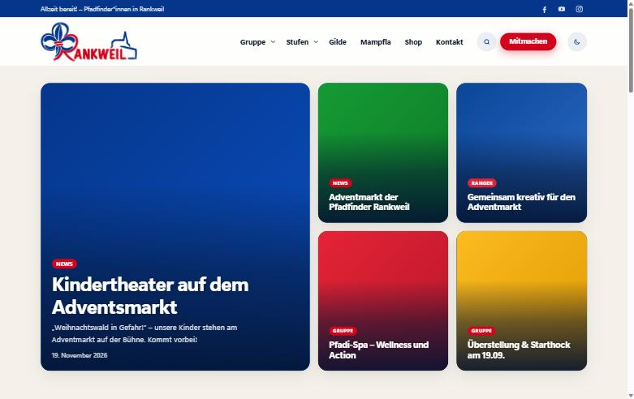
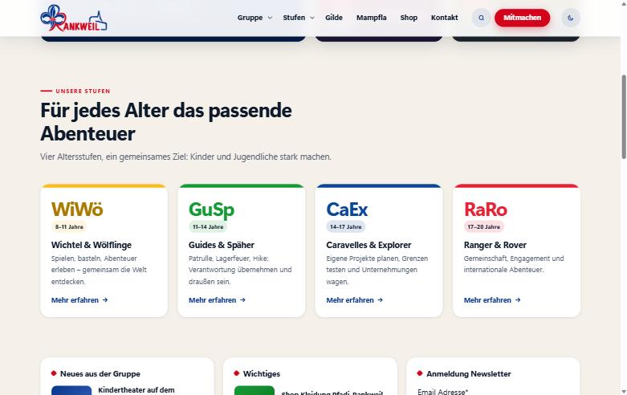
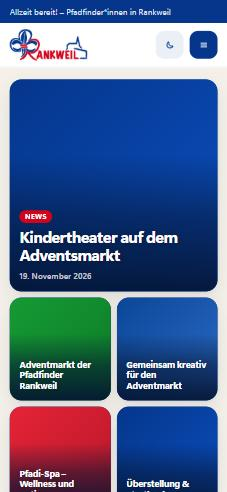
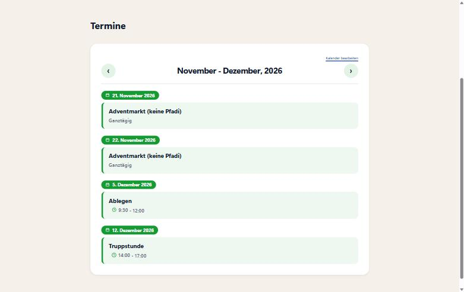

# Pfadi Rankweil – WordPress-Theme

Modernes, schnelles WordPress-Theme für die **Pfadfindergruppe Rankweil** ([pfadi-rankweil.at](http://www.pfadi-rankweil.at)).
Logo-Farben Navy & Rot, offizielle PPÖ-Stufenfarben, Dark Mode, viele Einstellungen im Customizer und ohne externe Schriften oder Tracker (DSGVO-freundlich).



| Stufen & Widgets | Dark Mode | Handy |
|---|---|---|
|  |  |  |

> Die Screenshots verwenden farbige Platzhalter statt der echten Beitragsfotos.

## Funktionen

- **Startseite**
  - Aufmacher als Kachel-Raster mit den neuesten Beiträgen (oder Willkommens-Banner)
  - Stufen-Kacheln (WiWö, GuSp, CaEx, RaRo) in den offiziellen PPÖ-Farben mit Altersangaben
  - Widgets der Seitenleiste als Karten („Neues aus der Gruppe“, „Wichtiges“, Newsletter)
  - Letzte Berichte als Karten, Mitmach-Banner
- **Beiträge**: klassischer Kopf (Titel und Bild in der Textspalte) oder großes Titelbild, Lesezeit, Teilen-Buttons ohne Tracking, ähnliche Beiträge
- **Kategorien**: Stufen-Labels in Stufenfarbe, „Gruppe“ → Stufe, Stufen-Archive in Stufenfarbe
- **Dark Mode** automatisch nach Systemeinstellung plus Umschalter
- **Plugins im Theme-Design**: Simple Calendar (Termine), Contact Form 7 (Anmeldung), Brevo-Newsletter
- **Kontakt-Tabelle** (Tabellen-Block mit Klasse `kontakt-liste`), am Handy als Karten
- **Mampfla-Archiv**: alle Ausgaben seit 1983 aus Issuu mit Viewer auf der eigenen Seite (Shortcode `[mampfla_archiv]`), aktualisiert sich automatisch
- **Widget „Beiträge mit Bild“** für die Seitenleiste
- **Sicherer Theme-Wechsel**: einmalige Übernahme von Logo/Menüs, Sicherung der Widget- und Menü-Anordnung in beide Richtungen
- **Updates direkt aus GitHub**: WordPress meldet neue Versionen, Update mit einem Klick



## Installation

1. Neueste Version bauen (siehe unten) oder ZIP aus `dist\` nehmen.
2. WordPress: *Design → Themes → Theme hinzufügen → Theme hochladen* → `pfadi-rankweil-<version>.zip`
   (bei einem Update „Aktuelle Version ersetzen“).
3. Einstellungen unter *Design → Anpassen → Pfadi Theme*.

Ausführliche Anleitung: [`pfadi-rankweil/README.md`](pfadi-rankweil/README.md) · Änderungen: [`CHANGELOG.md`](pfadi-rankweil/CHANGELOG.md)

## Neue Version veröffentlichen

```powershell
powershell -ExecutionPolicy Bypass -File tools\build.ps1 -Bump patch    # bzw. minor / major
# CHANGELOG.md ausfüllen, testen
powershell -ExecutionPolicy Bypass -File tools\build.ps1 -Force -Release -Push
```

Ergebnis: `dist\pfadi-rankweil-<version>.zip`, Commit „Version x.y.z“, Tag `vx.y.z`, Upload zu GitHub.
Die Versionsnummer steht nur im Kopf von `pfadi-rankweil/style.css`.

## Projektstruktur

```
pfadi-rankweil/       Theme (wird als ZIP hochgeladen)
  assets/css/main.css   gesamtes Design
  inc/                  Customizer, Hilfsfunktionen, Widgets, Theme-Wechsel, Updater, Issuu
  template-parts/       Startseiten-Bausteine
tools/build.ps1       Build & Versionierung
vorschau/             statische Vorschau ohne WordPress (node vorschau/server.js → localhost:8765)
docs/screenshots/     Bilder für diese Seite
dist/                 gebaute ZIPs (nicht im Repository)
```

## Lizenz

GPL v2 oder später. Das PPÖ-Verbandsabzeichen ist eine geschützte Marke und **nicht** Teil des Themes – es wird bei Bedarf im Customizer hochgeladen.
